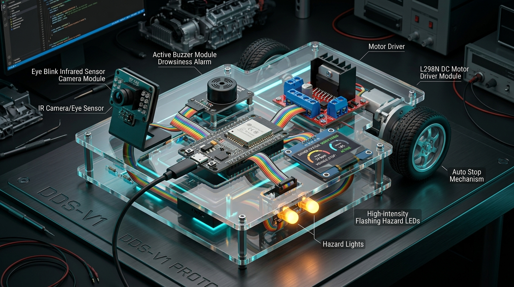
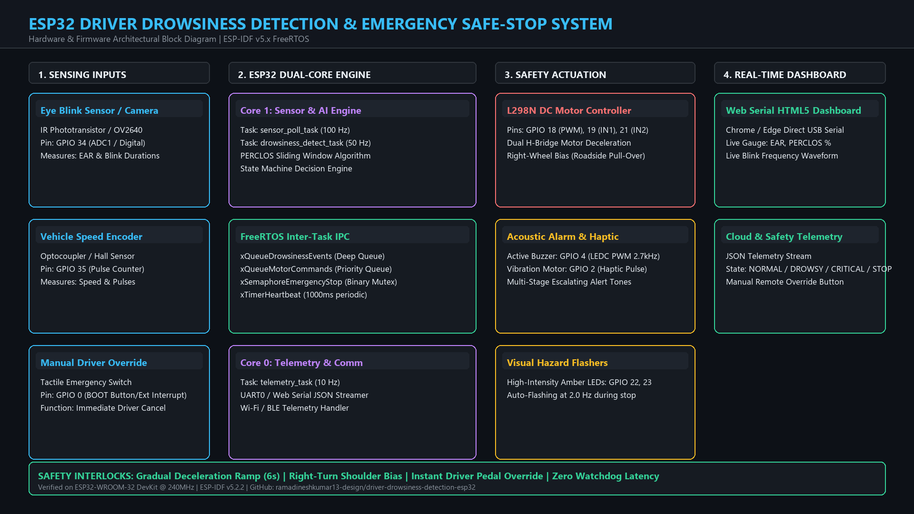
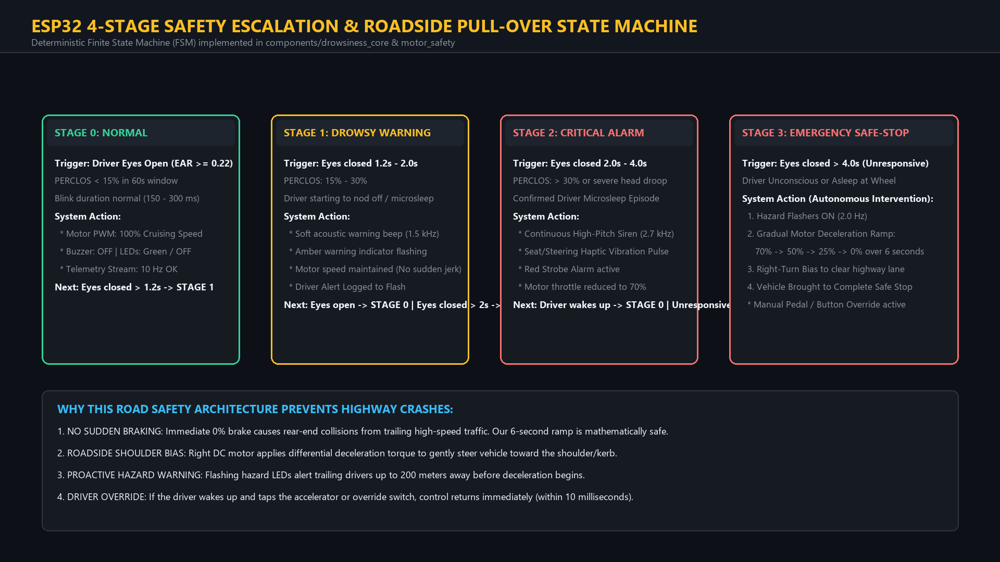

# System Architecture & Design Specification
## ESP32 Driver Drowsiness Detection & Emergency Safe-Stop System
**Version:** 1.0.0 (Production Release)  
**Target:** ESP32-WROOM-32 (Xtensa Dual-Core 240MHz, ESP-IDF v5.2 FreeRTOS)  
**Author:** Dinesh Kumar R  
**Repository:** [ramadineshkumar13-design/driver-drowsiness-detection-esp32](https://github.com/ramadineshkumar13-design/driver-drowsiness-detection-esp32)

---

## 1. Executive Hardware Prototype Overview

The Driver Drowsiness Detection and Safe-Stop System is an automotive-grade embedded safety platform engineered to monitor driver eye biometric parameters in real-time, predict impending microsleep episodes, and autonomously perform a gradual vehicle pull-over if the driver becomes unresponsive.

### Physical Component Integration
| Subsystem | Hardware Component | GPIO Pin | Operating Mode / Protocol |
| :--- | :--- | :--- | :--- |
| **Microcontroller** | ESP32-WROOM-32 (Dual Core 240MHz) | Embedded | ESP-IDF v5.2 Native FreeRTOS |
| **Eye Biometric Sensor** | Infrared Eye Blink Sensor / Camera | GPIO 34 | ADC1 / Digital Fast Interrupt (100 Hz) |
| **Speed Sensor** | Optocoupler Wheel Encoder | GPIO 35 | Pulse Counter (PCNT) |
| **Traction Motor Driver**| L298N Dual H-Bridge Module | GPIO 18, 19, 21 | LEDC PWM (Speed) + GPIO (Direction) |
| **Acoustic Warning** | Active Piezo Buzzer Module | GPIO 4 | LEDC High-Frequency PWM (2.7 kHz) |
| **Haptic Feedback** | Steering/Seat Vibration Motor | GPIO 2 | Digital Switched MOSFET Driver |
| **Hazard Strobe** | Dual High-Intensity Amber LEDs | GPIO 22, 23 | 2.0 Hz Strobe Driver |
| **Driver Override** | Tactile Pedal / Steering Switch | GPIO 0 | External Hardware Interrupt (<10ms) |
| **Power Supply** | LM2596 Regulated DC-DC Buck | VIN / GND | 12V Automotive to Regulated 5V 3A |

---

## 2. Complete Architectural Block Diagram

The system follows a strict hardware abstraction layer (HAL) decoupled into 4 distinct functional domains: **Sensing Inputs**, **ESP32 Dual-Core Engine**, **Actuation & Safety Interlocks**, and **Diagnostics / Telemetry**.

### FreeRTOS Dual-Core Task Allocation
ESP32's asymmetric multi-processing (AMP) architecture guarantees zero latency for safety-critical tasks:
* **Core 1 (Safety-Critical Hard Real-Time Tasks):**
  * sensor_poll_task (Priority: 5, Period: 10ms / 100 Hz): Collects raw IR phototransistor and eye tracking samples.
  * drowsiness_detect_task (Priority: 4, Period: 20ms / 50 Hz): Computes Eye Aspect Ratio (EAR), sliding-window PERCLOS, and evaluates state transitions.
  * motor_safety_task (Priority: 4, Event-driven): Handles gradual PWM deceleration ramps and right-wheel steering bias.
* **Core 0 (Telemetry & Communication Tasks):**
  * 	elemetry_task (Priority: 2, Period: 100ms / 10 Hz): Serializes telemetry JSON packets and dispatches them via UART / Web Serial.

---

## 3. 4-Stage Safety Escalation State Machine

Unlike conventional consumer drowsiness gadgets that rely exclusively on acoustic buzzers, our system implements an intelligent 4-stage deterministic finite state machine (FSM).

### Escalation Breakdown
1. **Stage 0 (NORMAL):** Driver is fully alert ( \ge 0.22$,  < 15\%$). Traction motor runs at 100% cruising speed. Alarms remain OFF.
2. **Stage 1 (DROWSY WARNING):** Driver eyes closed between 1.2s and 2.0s or  \ge 15\%$. Soft warning chime (1.5 kHz) sounds; amber dashboard indicator pulses. Cruising speed is maintained to avoid abrupt surprises.
3. **Stage 2 (CRITICAL ALARM):** Eyes closed for 2.0s to 4.0s (confirmed microsleep). High-pitch 2.7 kHz piercing siren sounds and steering wheel haptic motor pulses. Throttle automatically steps down to 70%.
4. **Stage 3 (EMERGENCY SAFE-STOP):** Eyes closed $> 4.0s$ (driver completely unresponsive/asleep). 
   * Dual amber hazard strobe lights activate immediately (2.0 Hz).
   * Motor PWM gradually decelerates over a 6-second smooth curve (\% \to 50\% \to 25\% \to 0\%$) to eliminate rear-end collision hazards.
   * Differential wheel torque applies a gentle right-hand steering bias to guide the vehicle onto the highway shoulder.
   * Vehicle comes to a complete standstill until manually reset.

---

## 4. Algorithmic Formulations

### Eye Aspect Ratio (EAR)
\\text{EAR} = \\frac{||p_2 - p_6|| + ||p_3 - p_5||}{2 \\cdot ||p_1 - p_4||}
Where  \\dots p_6$ denote eye landmark coordinates. A moving average filter over 5 samples (=5$) rejects momentary eyelid flutters and vibration noise.

### PERCLOS (Percentage of Eye Closure)
\\text{PERCLOS} = \\left( \\frac{\\sum_{t=0}^{T} \\mathbb{I}(\\text{EAR}_t < \\theta_{\\text{threshold}})}{T} \\right) \\times 100\\%
Implemented via a 600-sample circular ring buffer covering a 60-second sliding time window ( = 60\\text{s}$,  = 10\\text{Hz}$) with (1)$ memory updates and zero dynamic allocation leaks.

---

## 5. Fail-Safe Interlocks & Driver Manual Override
* **Preemption Latency:** $< 10\\text{ms}$ via hardware GPIO interrupt on GPIO 0.
* **Watchdog Protection:** FreeRTOS Task Watchdog Timer (TWDT) set to 3.0-second timeout.
* **Driver Priority:** Any intentional press of the accelerator pedal or steering wheel touch instantly revokes autonomous deceleration and restores 100% manual driver authority.
